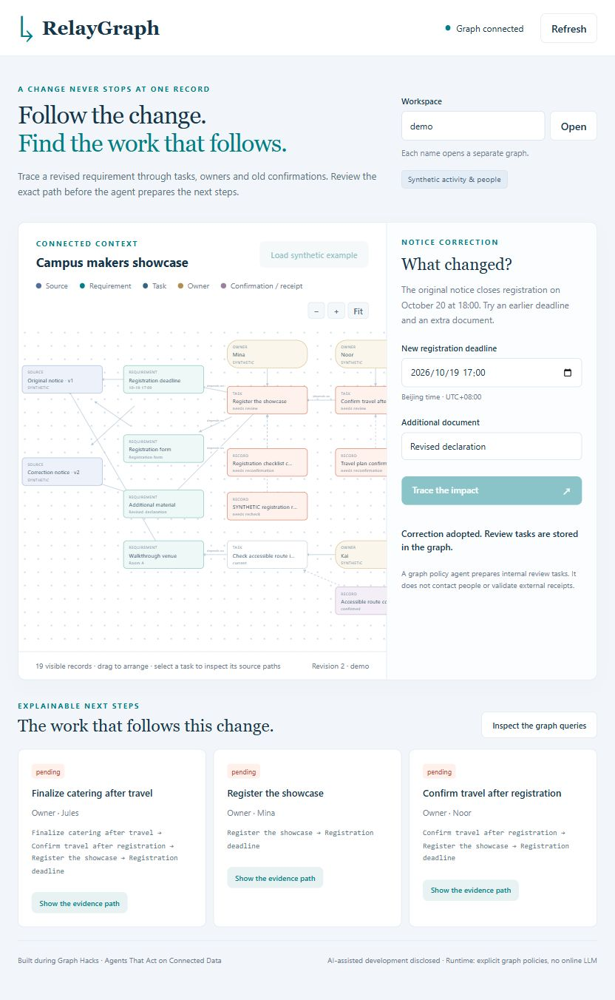

# RelayGraph

A graph-grounded change-response agent. One changed requirement reveals the tasks,
owners, confirmations and receipts that must be revisited, with an inspectable
Cypher path behind each decision.

Graph Hacks 2026 candidate. Track: **Agents That Act on Connected Data**.
Secondary fit: **Company Brain**. These are intended tracks, not registration or
submission receipts.

## Build provenance

The FalkorDB implementation, application and synthetic graph fixture are new work
started on 2026-10-18 during the event. Earlier local projects supplied domain
experience about notice revisions and evidence review; their source code and
private records are not copied into this submission. Generic libraries may be
used under their own licenses.

Codex assists implementation and verification. The default runtime agent follows
explicit graph-based policies; it does not call a paid language-model API. All
people, organizations, notices and receipts in the demo are synthetic. A runtime
policy decision is not represented as a language-model response or a human
approval. The participant must personally understand and verify the submission.

## Current readiness

Working localhost prototype verified against real FalkorDB 4.22.1. The graph
implementation, HTTP boundary, read-only MCP transport and restart/outage checks
have executable acceptance scripts. The browser flow was exercised through real
clicks, including proposal invalidation, adoption, evidence retrieval, node drag,
zoom and fit. Contest submission status is separate and is not claimed here.



## Run locally

Requirements: Python 3.12 or later and a running Docker Engine. No online model
API or paid service is required for the default demo.

```text
git clone https://github.com/dukeandBaron/relaygraph-graph-hacks-2026.git
cd relaygraph-graph-hacks-2026
docker compose up -d graph
python -m venv .venv
```

Windows:

```powershell
.venv/Scripts/python.exe -m pip install -r requirements.lock.txt
.venv/Scripts/python.exe run.py
```

macOS / Linux:

```sh
.venv/bin/python -m pip install -r requirements.lock.txt
.venv/bin/python run.py
```

Open **http://127.0.0.1:52188/**. The database is published only at
**127.0.0.1:6388**. Compose pins the official upstream image manifest and persists
data under this repository's ignored `runtime/graph-data` directory. This is a
localhost prototype, not an internet-facing multi-user deployment.

The local verification machine imported the same verified upstream layer and
config blobs through a Docker archive because its Docker proxy was unavailable.
The local converted image ID and upstream registry manifest digest differ; the
rootfs layers and entrypoint were verified before running. Import provenance is
not presented as an upstream Docker tag.

## Try the example

1. Enter a new lowercase workspace name, for example `review_demo`, and click
   **Open**. Every workspace name maps to its own graph.
2. Click **Load synthetic example**.
3. Leave the proposed earlier deadline and added declaration, then click
   **Trace the impact**.
4. Inspect the catering path: catering → travel → registration → deadline.
   Three tasks and four records need review; accessibility stays current.
5. Change the added document. The old proposal disappears and cannot be adopted.
   Prepare a new preview, review it, check confirmation and adopt it.
6. Inspect the owner-linked review actions, the old receipt's recheck status and
   the original and corrected source notices. Drag, zoom and fit the graph.
7. Reload. The graph retains the adopted correction and review actions. To replay
   the bounded one-correction example, open another workspace; no graph deletion
   or reset is needed.

## Architecture and queries

- `relaygraph/store.py`: FalkorDB-only state, revision-bound proposals and writes.
- `relaygraph/queries.py`: actual parameterized impact, evidence and action tools.
- `relaygraph/web.py`: same-origin local HTTP controller; 503 on a graph outage.
- `relaygraph/fixture.py`: synthetic graph data authored during the event.
- `web/`: vanilla SVG relationship UI, source drawer and inspectable queries.
- [Graph model and limits](docs/GRAPH_MODEL.md).
- [Contest fit and reuse boundary](docs/CONTEST_FIT.md).
- [Participant review](docs/PARTICIPANT_REVIEW.md).

The graph is essential: removing FalkorDB makes state, impact investigation,
adoption and review actions unavailable. The application has no JSON/SQL graph
fallback and no cached success response for an unavailable database.

## AI assistant context tools

`mcp_stdio.py` implements a small read-only MCP stdio server. It supports
`inspect_workspace`, `explain_task` and `list_review_actions`; arbitrary Cypher
and write commands are not exposed. Configure it in a caller's assistant only
after reviewing its scope. This example does not change any installed Codex or
other assistant settings:

```json
{
  "command": "PATH_TO_THIS_REPO/.venv/Scripts/python.exe",
  "args": ["PATH_TO_THIS_REPO/mcp_stdio.py"],
  "env": {"RELAYGRAPH_WORKSPACE": "review_demo", "FALKORDB_PORT": "6388"}
}
```

Use `.venv/bin/python` on macOS/Linux. The external assistant supplies its own
model; no model is invoked or purchased by this prototype.

## Verification

Use the environment's Python executable in place of `python` below:

```text
python tests/test_contracts.py
python tests/integration_graph.py
python scripts/http_acceptance.py
python scripts/check_mcp.py
```

The graph integration suite creates named synthetic test workspaces and retains
them. HTTP acceptance requires `run.py` to be running. The MCP acceptance script
expects the `demo` workspace to have been loaded at least once. Current receipts
in `artifacts/` preserve scope and distinguish actual FalkorDB from explicitly
injected HTTP boundary tests.

The local database restart check targets only this task's explicitly labeled
container. It verifies a real 503 outage response and the same state hash after
restart. Do not run this task-specific helper against an unrelated container.

## Limits

One correction per synthetic workspace; six-hop traversal; at most 32 workspace
handles per application process. Tenant graphs are logical demo separation, not
production access control. The app does not contact owners, validate an external
receipt, infer a real user's outcome or claim extraction accuracy. Current values
and historical source text are explicitly distinguished.
