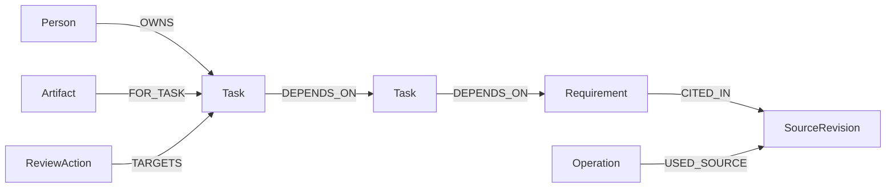

# Graph model and action loop

FalkorDB 4.22.1 was verified locally using the official linux/amd64 image.
`compose.yaml` pins the upstream manifest. The local Docker archive import
converts its manifest, so the local image ID is recorded separately from the
upstream manifest and original config digests.

All visible entities also carry an `Entity` label. `Meta` stores the graph
revision. Tenant names map to distinct, prefixed graph names; this is logical
workspace separation for a localhost prototype, not a production authentication
or authorization system.

An artifact has both its graph label `Artifact` and a business `kind` property
(`receipt` or `acknowledgement`). The HTTP representation deliberately exposes
the graph label as `kind` and the business property as `artifactKind` so one does
not overwrite the other.

## The central traversal

See `relaygraph/queries.py` for all actual queries. The impact tool follows up to
six `DEPENDS_ON` edges from tasks to the changed requirement. The catering task
reaches the deadline through travel and registration. The accessibility task
reaches only its venue, and is preserved as current.

## Decision and action loop

1. Observe a fully specified synthetic correction, with an explicit timezone.
2. Query FalkorDB for dependency paths, owners and affected artifacts.
3. Prepare a digest bound to workspace, graph revision, input and affected IDs.
4. Show the concrete proposal for explicit adoption.
5. Recompute and compare its basis. A single compare-and-set write updates the
   requirement, appends its new source revision, marks affected tasks and records
   for review, creates review actions, and records the operation digest.
6. Retrieve the actions and original source paths from the graph for inspection.

Read snapshots compare their starting and ending graph revision and reject a
mixed-revision result. Repeated identical operation IDs return the previous
result; reused IDs with different content are rejected. Source text stays
immutable, while current requirement values have explicit versions.

## AI integration

The default runtime policy is deterministic. It does not present a fabricated
LLM response. `mcp_stdio.py` exposes three read-only context tools for an external
AI assistant: inspect_workspace, explain_task and list_review_actions. The
assistant and its model are supplied by the caller; this package does not buy or
invoke an API. No installed Codex configuration is changed by the example.

## Deliberate limits

This is a bounded single-correction demonstrator with synthetic data, up to 32
local workspaces per application process and six dependency hops. It has no
natural-language extraction accuracy claim, automatic contact with owners,
external receipt verification, production identity system, or claimed real
customer results. Old source text and current values are displayed separately.
